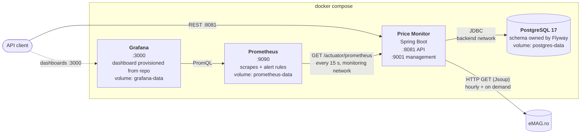
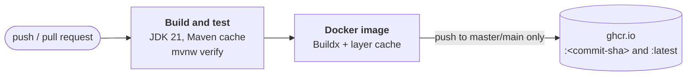
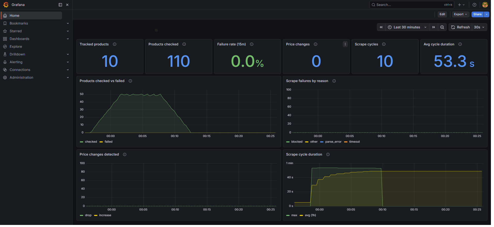
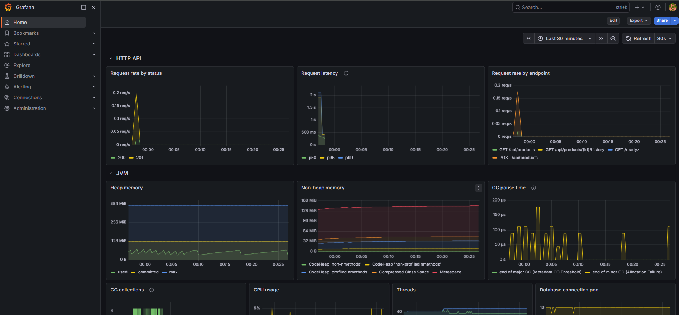

# Price Monitor

[](https://github.com/TiberiuSzabo/Price-monitor-spring/actions/workflows/ci.yml)

Spring Boot service that tracks product prices on eMAG.ro. You give it a product link (or a whole
search/category page), it scrapes the title and price with Jsoup, saves them, and re-checks every
product on a schedule so you get a price history over time.

It ships with a full local operations setup: one command starts the app, PostgreSQL, Prometheus and
Grafana, with health checks, metrics, a dashboard and an alert rule already wired together.

**Stack:** Java 21 · Spring Boot 4 · Spring Data JPA · PostgreSQL 17 · Flyway · Jsoup · Micrometer ·
Prometheus · Grafana · Docker Compose · GitHub Actions · JUnit 5 · Mockito · WireMock

## Architecture



- The app is the only container on both networks. Prometheus and Grafana sit on `monitoring` and
  cannot reach the database; PostgreSQL sits on `backend` and cannot be reached by them.
- Operational endpoints (health details, metrics, manual scrape trigger) are served on a separate
  **management port (9001)**, never on the public API port.
- Start order is enforced with health checks: PostgreSQL → app → Prometheus → Grafana.

## Run it

Requires Docker with Compose v2. Nothing else — no JDK, no `.env` file.

```bash
docker compose up -d --build
```

The first build downloads the Maven dependencies and takes a few minutes. Check that everything is
healthy with `docker compose ps`.

| What | URL | Credentials (dev defaults) |
| --- | --- | --- |
| REST API | http://localhost:8081/api/products | none |
| Liveness / readiness | http://localhost:8081/livez · http://localhost:8081/readyz | none |
| Health (details) | http://localhost:9001/actuator/health | none (loopback only) |
| Metrics | http://localhost:9001/actuator/prometheus | none (loopback only) |
| Build info | http://localhost:9001/actuator/info | none (loopback only) |
| Grafana | http://localhost:3000 — opens on the *Price Monitor* dashboard | `admin` / `admin` |
| Prometheus | http://localhost:9090 — targets: `/targets`, alerts: `/alerts` | none |
| PostgreSQL | `localhost:5432`, database `pricemonitor` | `pricemonitor` / `pricemonitor` |

Everything except the REST API is bound to `127.0.0.1`. The defaults above are for local development
only: copy `.env.example` to `.env` to change passwords and ports (`.env` is git-ignored).

Try it:

```bash
# track a product (scrapes it right away)
curl -X POST localhost:8081/api/products -H "Content-Type: application/json" \
  -d '{"url":"https://www.emag.ro/telefon-mobil-apple-iphone-17-pro-256gb-5g-cosmic-orange-mg8h4zd-a/pd/D099FV3BM/"}'

# run a full scrape cycle now instead of waiting for the hourly schedule
curl -X POST localhost:9001/actuator/scrapecycle

# see the scraper metrics
curl -s localhost:9001/actuator/prometheus | grep pricemonitor_
```

Stop with `docker compose down` (data is kept) or `docker compose down -v` (data is deleted).

### Run the app from the IDE

```bash
docker compose up -d postgres        # just the database
cd priceMonitor
./mvnw spring-boot:run               # Windows: mvnw.cmd spring-boot:run
```

With no profile set the app uses `dev`, whose defaults match the Compose database.

## API

| Method | Path | Body | Description |
| --- | --- | --- | --- |
| `POST` | `/api/products` | `{"url": "<product link>"}` | Track a product (scrapes it right away) |
| `POST` | `/api/products/discover` | `{"url": "<search/category link>"}` | Track every product on a listing page |
| `GET` | `/api/products` | | Tracked products with current price |
| `GET` | `/api/products/{id}/history` | | Price history of one product |
| `DELETE` | `/api/products/{id}` | | Stop tracking a product |

Errors come back as `application/problem+json`: `400` bad URL, `404` unknown product,
`502` when eMAG can't be read. Only `emag.ro` URLs are accepted, so the API can't be used to fetch
arbitrary sites.

## How the scraper works

- **Scraping:** `ScraperService` reads `h1.page-title` and the main price (`[data-test=main-price]`,
  falling back to `.product-new-price` and then the JSON-LD `offers.price`). eMAG prices look like
  `6.199,00 Lei`, so `.` is the thousands separator and `,` the decimal one.
- **Discovery:** on a listing page it collects every `a.card-v2-title` link and strips the tracking
  query params, so the same product isn't stored twice.
- **History:** every check adds a `price_point` row; `product` keeps the latest price.
- **Scheduler:** `PriceScheduler` re-checks all products every hour (configurable), with a pause
  between requests so the site isn't hammered.
- **Failure classification:** every failed check gets a reason — `timeout`, `blocked` (HTTP 403/429
  or a captcha page), `parse_error` (page loaded but title/price missing) or `other`. The reason is
  logged and becomes a metric label, so "eMAG changed its markup" and "eMAG is blocking us" are
  distinguishable at a glance.

## Configuration

All configuration comes from environment variables. Two Spring profiles:

| Profile | Used for | Behaviour |
| --- | --- | --- |
| `dev` (default) | IDE / `mvnw spring-boot:run` | Readable logs; every variable has a default pointing at the local Compose database |
| `prod` | Containers | JSON logs; database variables are required — the app refuses to start without them |
| `test` | Automated tests | In-memory H2 in PostgreSQL mode, scheduler effectively off |

| Variable | Default | Meaning |
| --- | --- | --- |
| `SPRING_PROFILES_ACTIVE` | `dev` (Compose sets `prod`) | Active profile |
| `DB_URL` / `DB_USERNAME` / `DB_PASSWORD` | dev only | JDBC connection |
| `SERVER_PORT` | `8081` | Public API port |
| `MANAGEMENT_PORT` | `9001` | Actuator port |
| `PRICEMONITOR_CHECK_INTERVAL_MS` | `3600000` | Time between scrape cycles |
| `PRICEMONITOR_DELAY_BETWEEN_REQUESTS_MS` | `5000` | Pause between two requests to eMAG |
| `PRICEMONITOR_HTTP_TIMEOUT_MS` | `10000` | Timeout for one page fetch |

`.env.example` lists the variables Compose understands (database and Grafana credentials, host ports).

## Database

PostgreSQL, with the schema owned by **Flyway** (`priceMonitor/src/main/resources/db/migration`).
Hibernate runs with `ddl-auto=validate`: it never changes the schema, it only checks at startup that
the entities still match it.

To change the schema, add a new file (`V2__add_something.sql`) — never edit one that has been applied.
The tests apply the same migrations to H2, so a migration that doesn't match the entities fails the build.

## Observability

### Metrics

Exposed in Prometheus format at `:9001/actuator/prometheus`.

| Metric | Type | Labels | Meaning |
| --- | --- | --- | --- |
| `pricemonitor_products_checked_total` | counter | | Product pages the scraper tried to read |
| `pricemonitor_scrape_failures_total` | counter | `reason` = `timeout` \| `blocked` \| `parse_error` \| `other` | Checks that failed, by cause |
| `pricemonitor_price_changes_total` | counter | `direction` = `drop` \| `increase` | Checks where the price differed from the previous one |
| `pricemonitor_scrape_cycle_seconds_{count,sum,max}` | timer | | Duration of one full pass over all products |
| `pricemonitor_products_tracked` | gauge | | Products currently in the database |

All series exist from startup with value 0, so rates and the alert work from the first scrape.
The standard Spring Boot metrics are there too: `http_server_requests_seconds_*` (with histogram
buckets for percentiles), `jvm_memory_*`, `jvm_gc_pause_seconds_*`, `jvm_threads_*`,
`process_cpu_usage`, `hikaricp_connections_*`.

### Dashboard

Grafana is provisioned from the repo — datasource and dashboard are files under `monitoring/grafana`,
so a fresh `docker compose up` gives the same dashboard every time, with no clicking.
The *Price Monitor* dashboard has three rows:

- **Scraper** — tracked products, checks, failure rate, failures by reason, price changes, cycle duration
- **HTTP API** — request rate by status and endpoint, latency p50/p95/p99
- **JVM** — heap and non-heap memory, GC pauses and collections, CPU, threads, connection pool

### Alerts

Rules live in `monitoring/prometheus/rules/price-monitor.yml` and show up at http://localhost:9090/alerts.

| Alert | Fires when |
| --- | --- |
| `ScrapeFailureRateHigh` | More than 20% of product checks failed over the last 15 minutes |
| `PriceMonitorDown` | Prometheus could not scrape the app for 2 minutes |

There is no Alertmanager in this stack, so alerts are evaluated and displayed but not sent anywhere.

### Logs

In the `prod` profile every log line is one JSON object (Elastic Common Schema), ready for a log
collector:

```bash
docker compose logs -f app
```

## Tests

```bash
cd priceMonitor
./mvnw verify
```

No test talks to eMAG:

- **Parser** — `ScraperServiceTest` runs against HTML snippets and saved pages in
  `src/test/resources/fixtures`.
- **HTTP layer** — `ScraperServiceHttpTest` starts a local **WireMock** server that plays eMAG: it
  serves the saved pages, returns 403/429/5xx, serves a captcha page and delays a response past the
  timeout, then checks both the failure reason and the metric that moved.
- **Price-change detection** — `PriceServiceTest` (drop, increase, unchanged, first sighting) on
  in-memory H2 with the real Flyway migration.
- **Scheduler** — `PriceSchedulerTest` (one failing product doesn't stop the cycle; cycles are timed).

## CI/CD

`.github/workflows/ci.yml`, on every push and pull request:



1. **Build and test** — sets up Temurin 21 with the Maven repository cached on `pom.xml`, runs
   `./mvnw verify`. Test reports are uploaded as an artifact when it fails.
2. **Docker image** — runs only if the tests pass. The image is built on every run (so a broken
   Dockerfile is caught in the pull request) with layers cached in the GitHub Actions cache.
   On a push to the default branch it is also pushed to GitHub Container Registry, tagged with the
   full commit SHA and `latest`, authenticating with the built-in `GITHUB_TOKEN`.

```bash
docker pull ghcr.io/tiberiuszabo/price-monitor-spring:latest
```

## Project layout

```
.
├── docker-compose.yml            # app + postgres + prometheus + grafana
├── .env.example                  # variables Compose understands
├── .github/workflows/ci.yml      # test, build image, push to ghcr.io
├── monitoring/
│   ├── prometheus/               # scrape config and alert rules
│   └── grafana/                  # provisioned datasource and dashboard
└── priceMonitor/                 # the Spring Boot application
    ├── Dockerfile                # multi-stage, layered jar, non-root
    └── src/main/resources/
        ├── application*.properties   # base + dev + prod profiles
        └── db/migration/             # Flyway migrations
```

## Screenshots

Both are the provisioned *Price Monitor* dashboard after tracking 10 real eMAG products and running
10 scrape cycles one minute apart.



*Scraper row — 10 tracked products, 110 checks with a 0% failure rate, and each full cycle taking about 53 seconds.*



*HTTP API and JVM rows — request rate and latency percentiles per endpoint, heap usage against the 384 MiB limit, and GC pause time.*

## Next

- Email alert when a price drops under a target (JavaMailSender)
- Alertmanager, so the Prometheus alerts are actually delivered
- Store prices as `NUMERIC` / `BigDecimal` instead of `double`
